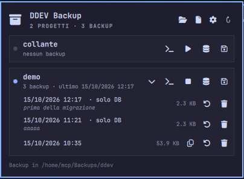

# Omarchy DDEV Backup

🇬🇧 [English](README.md) · 🇮🇹 Italiano

Plugin per la barra di Omarchy 4.x che fa backup e restore completi dei progetti [DDEV](https://ddev.com): **sorgenti, configurazione (`.env`, `.ddev/`) e tutti i database** in un unico file `.zip`, con un clic.



## Funzioni

- **Backup completo** di un progetto in un file `.zip`: l'intera cartella del progetto più un dump di ogni database del container (non solo `db`). Se il progetto è fermo viene avviato per esportare i database e poi rifermato.
- **Backup del solo database**, con una nota facoltativa (ad esempio "prima della migrazione"): veloce, da fare prima di un'operazione rischiosa.
- **Restore** sul posto, esatto: file e database tornano come al momento del backup, e quelli creati dopo vengono rimossi. Prima di sovrascrivere viene sempre fatto un **backup di sicurezza** dello stato attuale; se il restore fallisce la cartella originale viene rimessa al suo posto.
- **Anteprima prima del restore**: data, tipo, nota, database, branch e commit git (e se c'erano modifiche non committate), cartella originale, computer e versione di DDEV, dimensione.
- **Ripristina come copia**: crea un nuovo progetto DDEV da un backup, con nome e cartella a scelta, senza toccare l'originale.
- **Ripristina da file**: un `.zip` scelto con il file chooser, ad esempio copiato da un altro computer. Anche i progetti eliminati da DDEV si possono ripristinare dalla lista.
- Per ogni progetto anche **avvio/arresto** (`ddev start` / `ddev stop`) e **terminale** aperto nella cartella del progetto.
- **Conservazione automatica**: tiene gli ultimi N backup completi e gli ultimi M backup del solo database per progetto.
- **Sicurezza delle operazioni**: una sola operazione alla volta per progetto, controllo dello spazio su disco prima di iniziare, verifica degli sha256 dei dump prima di ogni restore.
- Database supportati: **MariaDB, MySQL e PostgreSQL**.
- Tutto si fa anche da terminale con lo script `bin/ddev-backup`, che il pannello usa a sua volta.

## Requisiti

- Omarchy 4.x con Omarchy Shell (Quickshell).
- [DDEV](https://ddev.com/get-started/) con Docker in esecuzione.
- `bash`, `jq`, `bsdtar` (libarchive), `unzip` e `notify-send` (libnotify), già presenti in Omarchy.

## Installazione

```bash
omarchy plugin add https://github.com/zeroviger/omarchy-ddev-backup.git --enable
```

Il widget viene messo nella sezione destra della barra. Per spostarlo:

```bash
omarchy bar move mcp64.ddev-backup --section left   # oppure center
```

## Utilizzo

Clic sull'icona dell'archivio nella barra. Per ogni progetto DDEV:

| Pulsante | Azione |
|---|---|
| ›  | Mostra i backup del progetto |
| >_ | Apre un terminale nella cartella del progetto |
| ▶ / ■ | Avvia o ferma il progetto |
| 🛢 | Backup del solo database, con nota facoltativa |
| 💾 | Backup completo |

Per ogni backup nella lista:

| Pulsante | Azione |
|---|---|
| ⧉ | Ripristina come copia (solo backup completi): nome e cartella del nuovo progetto |
| ↺ | Ripristina, dopo l'anteprima e una conferma |
| 🗑 | Elimina, dopo una conferma |

Nell'intestazione del pannello: apri la cartella dei backup, ripristina da un file `.zip`, impostazioni, aggiorna.

Esc chiude prima la conferma o il modulo aperto, poi il pannello. Il pannello si apre anche da terminale o con una scorciatoia:

```bash
qs -p /usr/share/omarchy/shell ipc call mcp64.ddev-backup toggle
```

### Da terminale

```bash
B=~/.config/omarchy/plugins/mcp64.ddev-backup/bin/ddev-backup
$B list                                              # progetti e backup (JSON)
$B backup mioprogetto                                # backup completo
$B backup mioprogetto --db-only --label "prima della migrazione"
$B inspect ~/Backups/ddev/mioprogetto/mioprogetto-20261015-102100.zip
$B restore <file.zip> --force                        # sovrascrive il progetto
$B restore <file.zip> --to ~/Projects/copia --name copia   # crea una copia
$B delete <file.zip>
```

Un backup del solo database si ripristina sul progetto esistente con lo stesso nome (o `--name`) e non tocca i file.

## Cosa contiene il backup

```
manifest.json          progetto, tipo di backup, nota, versione DDEV, database, git, sha256 dei dump
database/<db>.sql.gz   un dump per ogni database
files/                 l'intera cartella del progetto (solo nei backup completi)
```

I file si chiamano `<progetto>-AAAAMMGG-HHMMSS[-db][-pre-restore][-nota].zip` e stanno in `<cartella dei backup>/<progetto>/`. Sono normali `.zip`: si aprono con qualsiasi programma.

Esclusi dai backup: i file che DDEV rigenera da solo (`.ddev/.ddev-docker-compose-*`, `.ddev/db_snapshots`, `.ddev/traefik/certs`, …) e i pattern impostati in **Escludi** (di default `node_modules`). Per escludere altro da un solo progetto, crea nella sua cartella un file `.ddev-backup-ignore` con un pattern per riga.

## Come funziona il restore

1. Controlla lo spazio libero, estrae lo zip in una cartella temporanea accanto alla destinazione e verifica gli sha256 dei dump.
2. Se il progetto esiste già: backup di sicurezza (`…-pre-restore.zip`), poi `ddev delete` (container e database, non i file).
3. Sostituisce la cartella, esegue `ddev start` e `ddev import-db` per ogni database.
4. Se qualcosa fallisce rimette la cartella originale e indica il comando per recuperare il database dal backup di sicurezza.

Con PostgreSQL le connessioni aperte verso i database da sostituire (applicazione, worker, client) vengono chiuse, perché Postgres non permette altrimenti di eliminarli. Le cartelle escluse dal backup, come `node_modules`, dopo il restore vanno rigenerate (ad esempio `ddev npm install`).

## Configurazione

Dall'ingranaggio ⚙ del pannello. I valori sono salvati nella voce del widget in `~/.config/omarchy/shell.json`, dove li legge anche lo script da terminale:

| Chiave      | Default          | Descrizione |
|-------------|------------------|-------------|
| `backupDir` | `~/Backups/ddev` | Cartella dei backup (una sottocartella per progetto) |
| `keep`      | `10`             | Backup completi conservati per progetto (0 = tutti) |
| `keepDb`    | `20`             | Backup del solo database conservati per progetto (0 = tutti) |
| `exclude`   | `node_modules`   | Pattern esclusi dai backup, separati da virgola |
| `notify`    | `true`           | Notifica a fine backup e restore |

Esempio:

```json
{ "id": "mcp64.ddev-backup", "backupDir": "/mnt/nas/ddev", "keep": 5, "exclude": "node_modules, vendor" }
```

oppure da terminale: `omarchy bar set mcp64.ddev-backup keep 5 --json`.

I backup di sicurezza fatti prima di un restore non contano nei limiti e non vengono mai cancellati automaticamente.

## Rimozione

```bash
omarchy plugin remove mcp64.ddev-backup
```

I backup nella cartella dei backup (di default `~/Backups/ddev`) non vengono cancellati.

## Limiti e avvertenze

- **I backup non sono cifrati** e contengono `.env`, chiavi e dati del database. Tienili in un posto sicuro, soprattutto se la cartella dei backup è su un disco condiviso.
- Il restore è esatto: tutto ciò che è stato creato dopo il backup sparisce dal progetto (resta nel backup di sicurezza).
- Il controllo dello spazio riguarda la cartella dei backup e quella del progetto, non lo spazio di Docker usato durante l'importazione dei database.
- Con PostgreSQL il restore interrompe le connessioni dell'applicazione al database: worker e processi in esecuzione dovranno riconnettersi.
- I nomi dei progetti possono contenere solo lettere, cifre e trattini, come richiede DDEV.

## Sviluppo e test

```bash
test/run-tests.sh
```

Test end-to-end (circa 8 minuti): creano progetti DDEV usa e getta sotto `~/.cache` (uno MariaDB e uno PostgreSQL), provano backup completi e del solo database, restore, copia, rollback, checksum, lock, spazio insufficiente, impostazioni, conservazione e cancellazione, poi rimuovono tutto. Richiedono Docker e DDEV attivi; usano `shellcheck` se installato.

## Licenza

MIT. Vedi [LICENSE](LICENSE).
